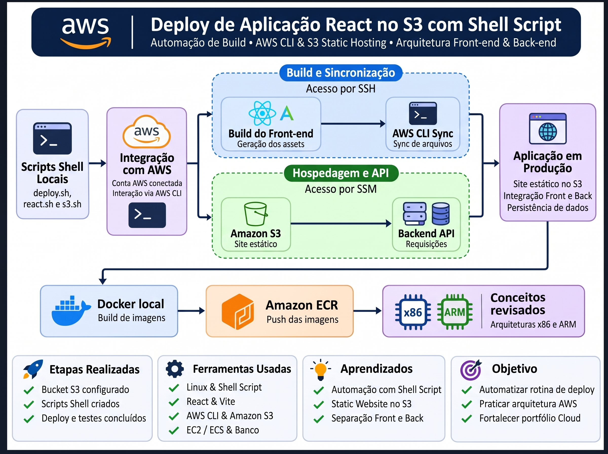
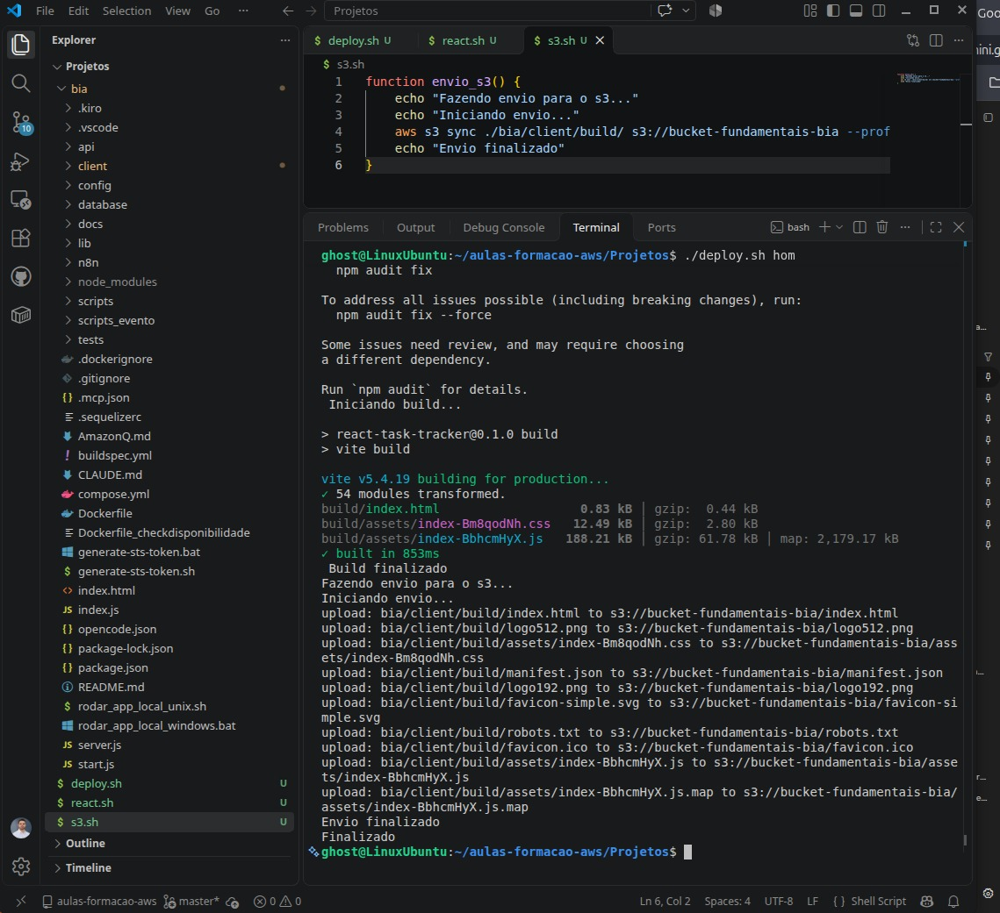
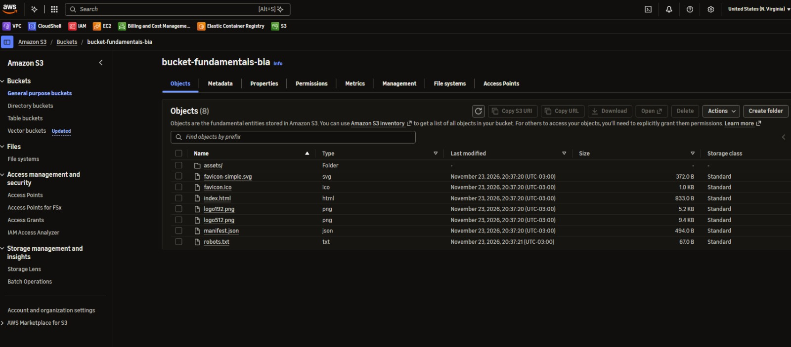
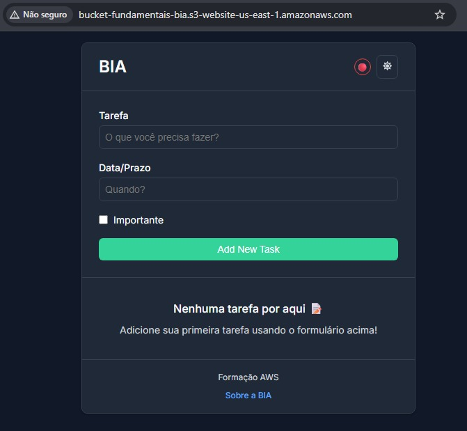

# ☁️ AWS S3 Static Hosting & Shell Script Deployment Lab

**Automated React Front-End Build & Amazon S3 Synchronization Pipeline on Linux**

---

## 🗺️ Architecture & Workflow Flowchart

Practical cloud deployment automation built on a Linux environment, decoupling front-end static asset delivery from back-end API compute services. Modular Shell Scripts (`deploy.sh`, `react.sh`, and `s3.sh`) orchestrate production React/Vite builds and synchronize static artifacts directly to an Amazon S3 bucket configured for Static Website Hosting[cite: 15, 16, 18].

---

## 🛠️ Technologies & Tools

* **Cloud Infrastructure:** Amazon S3 (Static Website Hosting, Object Synchronization), Amazon EC2 / ECS, AWS Systems Manager (SSM), Amazon ECR[cite: 15, 16, 18, 19]
* **Operating System & Automation:** Linux (Ubuntu), Bash / Shell Scripting (`deploy.sh`, `react.sh`, `s3.sh`), AWS CLI v2 (`aws s3 sync`)[cite: 15, 16]
* **Front-End Build Toolchain:** React, Vite, Node.js / npm[cite: 15, 16]
* **Version Control & IDE:** Git, GitHub, Visual Studio Code

---

## 🧪 Execution & Validation Evidence

| Automated Shell Script Build & S3 Sync | Amazon S3 Bucket Object Verification |
| :---: | :---: |
|  |  |

| Production Static Website Endpoint (Amazon S3) |
| :---: |
|  |

---

## 📄 Full Technical Documentation

* 📋 [Access Detailed Lab Report (PDF)](docs/04-s3-static-deploy-documentation.pdf)

---

## 👤 Author

**Tiago Donega** — Cloud & DevOps Engineering  

